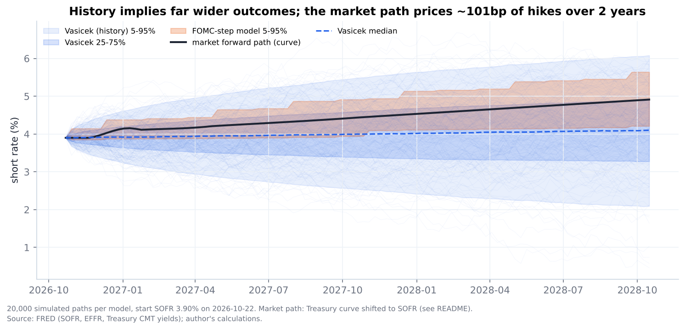
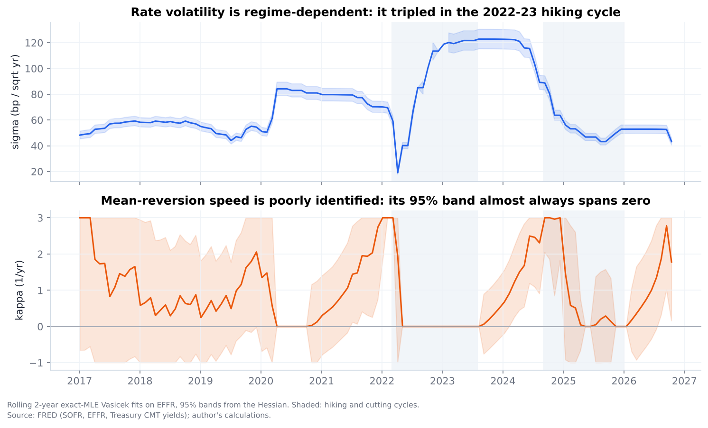
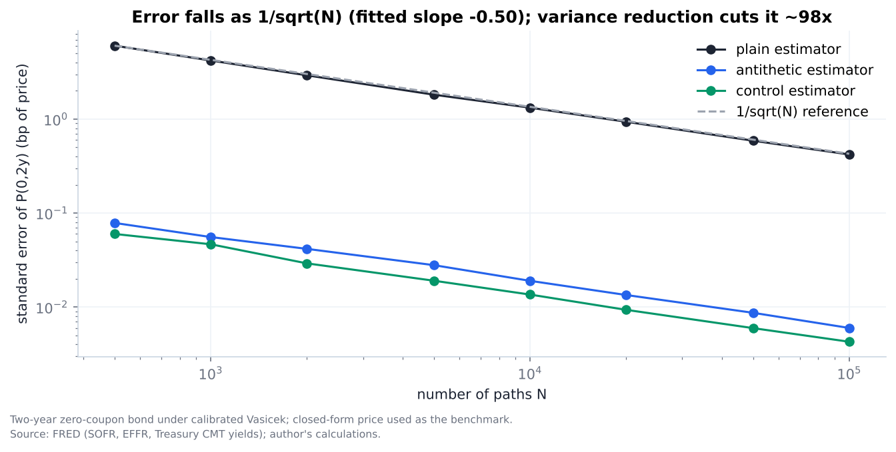
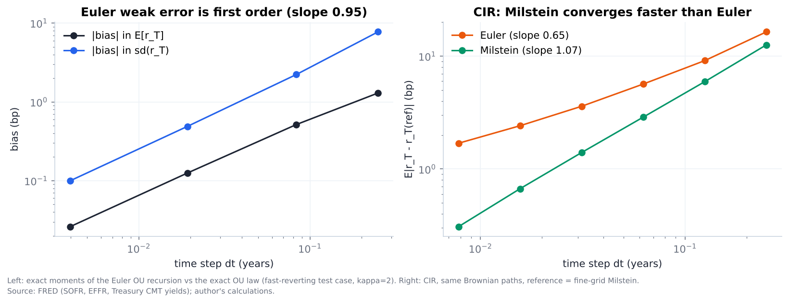
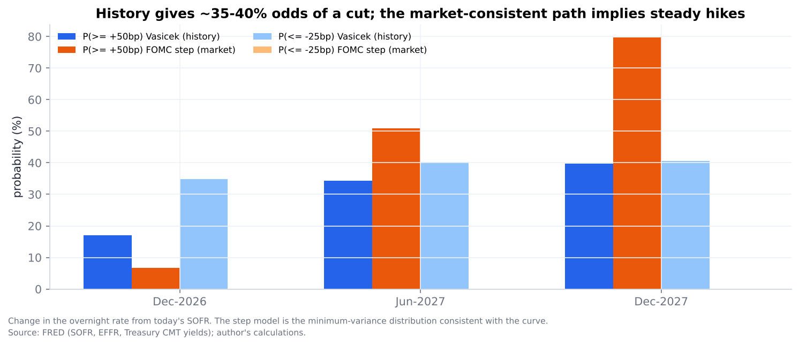
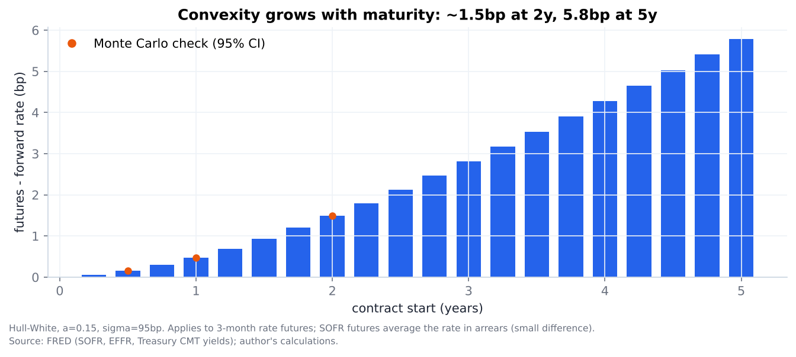
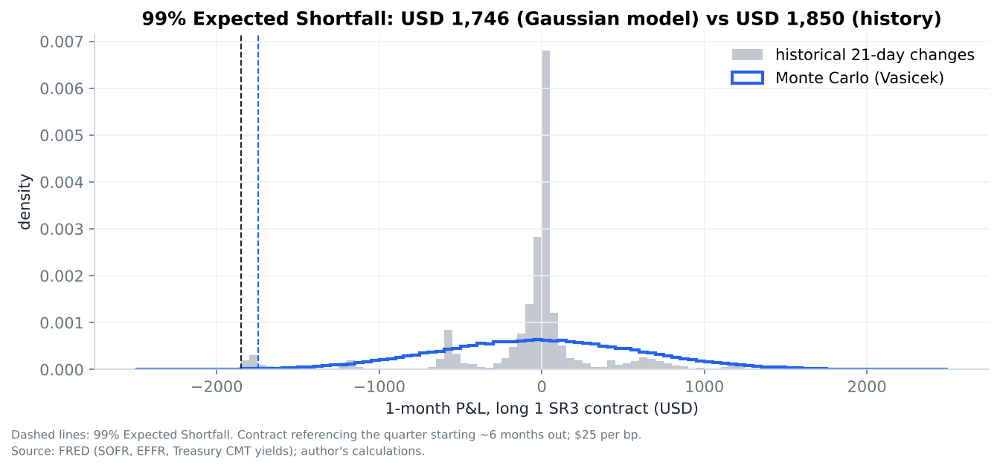

# Monte Carlo Simulation of US Short-Rate Paths

**How wide is the range of plausible US short-rate paths, how likely is each Fed scenario, and what do the futures convexity adjustment and 1-month tail risk look like?** Short-rate models (Vasicek / Ornstein–Uhlenbeck, CIR, Hull–White) calibrated to SOFR history and to today's curve, with a validated Monte Carlo engine.

**[Interactive report](https://atharvadeshpande002.github.io/rates-monte-carlo/reports/report.html)** · [Walkthrough notebook](notebooks/walkthrough.ipynb) · [Interview notes](INTERVIEW_NOTES.md)

Data: FRED SOFR (2,137 daily fixings, Apr-2018 to 22-Oct-2026), EFFR (2015–2026) and Treasury yields 1M–2Y on 22-Oct-2026.

## Key findings

- **History pins down volatility but not mean reversion.** Exact maximum likelihood (identical to OLS on the AR(1) form) gives σ = 95 bp/√yr (standard error 1.5 bp) but κ = 0.11 with a 95% interval of [−0.22, 0.45]. Daily rates move in FOMC steps, so history says little about the pull back to a long-run level. Two repo-spike days alone would inflate σ to 166 bp.
- **History and the market disagree on direction.** The curve prices ~100 bp of hikes over two years (76% odds of a 25 bp hike in December 2026). The history-calibrated model gives a 35–41% chance of at least a 25 bp *cut* at every horizon and a 2-year standard deviation of ~98 bp, three times the dispersion of the market-consistent step path.
- **The Monte Carlo engine behaves as theory says.** Error falls as 1/√N (fitted slope −0.50). Antithetic variates cut variance ~4,900× and a control variate ~9,700× for the bond price. Euler's weak error is first order (0.95); for CIR, Milstein's strong error converges at order 1.07 vs 0.65 for Euler.
- **Pricing checks out against closed forms.** Hull–White reprices today's curve with zero error. A 1y×3m caplet struck at 4.50% is worth 8.61 bp of notional in closed form; Monte Carlo (100k paths) gives 8.68 ± 0.08 bp. The futures convexity adjustment is 0.5 bp at 1 year, 1.5 bp at 2 years and 5.8 bp at 5 years.
- **Gaussian risk understates the tail.** For one SR3 contract, 1-month 95% Expected Shortfall is $1,351 under the model vs $1,654 from history (+22%), because realised rate changes are peaked with fat tails (2020 emergency cuts, 2022 75 bp hikes).



## Why this matters on a desk

- **Scenario probabilities** ("what are the odds of a cut by June?") are what STIR traders quote. Comparing a history-based model with the market-consistent path shows where the market may be over-confident.
- **Convexity** must be subtracted from futures rates before comparing them with swaps or FRAs; it grows with maturity and volatility.
- **VaR / Expected Shortfall** under a Gaussian model is a floor, not a ceiling: FOMC jumps fatten the tails.
- The same engine prices options and validates every number against a closed form, which is how a pricing library should be tested.

## Method

| Step | What | How |
|---|---|---|
| Data | SOFR, EFFR, Treasury 1M–2Y | FRED; one-day reversing spikes (17-Sep-2019 repo stress, 30-Sep-2019) removed, FOMC steps kept |
| Theory | OU / Vasicek, CIR, Hull–White | Langevin equation → OU; Fokker–Planck stationary law N(θ, σ²/2κ) |
| Calibration | Vasicek, CIR | OLS on AR(1) and exact MLE; standard errors from the Hessian; CIR via the non-central χ² density; rolling 2-year fits |
| Simulation | Exact OU, Euler, Milstein | Vectorised NumPy, fixed seeds; convergence and discretisation-error studies |
| Variance reduction | Antithetic, control variate | Control Y = ∫r dt with known mean θT + (r₀−θ)(1−e^(−κT))/κ |
| Market path | Hull–White θ(t) | Fitted to the Treasury curve shifted so its short end equals SOFR |
| FOMC model | 25 bp steps | Expected change per meeting split between the two neighbouring 25 bp outcomes |
| Pricing | Caplet, convexity | HW closed forms (bond-option formula; Hull's convexity formula) checked by Monte Carlo |
| Risk | VaR, ES | 1-month P&L of long 1 SR3 ($25/bp): Monte Carlo vs historical simulation |

## Results

| Figure | Finding |
|---|---|
|  | Volatility tripled in the 2022–23 hikes; κ's 95% band almost always spans zero |
|  | 1/√N convergence; variance reduction ~70–100× in standard error |
|  | Euler weak order ~1; CIR Milstein beats Euler |
|  | History gives real odds to cuts; the market path implies steady hikes |
|  | Convexity grows with maturity; Monte Carlo matches the formula |
|  | Historical tails are fatter than the Gaussian model |

All tables are in `reports/tables/`, all numbers in `reports/results.json`.

## Limitations

- **Mean reversion is weakly identified** from 8 years of daily data; θ is not a forecast.
- **One factor:** every maturity moves together; no curve twists or steepeners.
- **Market path from Treasuries, not SR3:** bills trade at a spread to SOFR, so the curve is shifted to SOFR and only its shape is used. With SR3 settlements the curve should be built from futures.
- **The two-outcome FOMC split** is the minimum-variance distribution consistent with the curve: it shows the central path, not tail risk. Meeting dates after 2026 are assumed (typical calendar).
- **Hull–White parameters** come from history (σ = 95 bp, a = 0.15); a desk would calibrate them to cap/swaption volatilities.
- **SOFR futures average the rate in arrears**; the convexity formula is for a forward-looking 3-month rate (small difference).
- **Gaussian rates** can go negative (0.8% stationary probability here); CIR fixes this at the cost of a non-Gaussian likelihood.

## How to run

```bash
pip install -r requirements.txt
python scripts/download_data.py     # FRED data into data/raw/ (not committed)
python scripts/run_all.py           # every number, table, chart and reports/report.html
python scripts/screen_today.py      # desk screen for the latest date
pytest -q                           # 11 checks: closed forms vs simulation, estimator identities
```

Parameters live in `config.yaml`. Code: `src/ratesmc/` (`data`, `models`, `calibration`, `montecarlo`, `fomc`, `risk`, `plots`).

## Next steps

- Jump-diffusion: OU noise plus FOMC jumps sized from meeting probabilities.
- Two-factor Hull–White (G2++) for curve shape; calibrate to swaption volatilities.
- Build the market curve from SR3 settlements and price SR3 options against market premiums.
